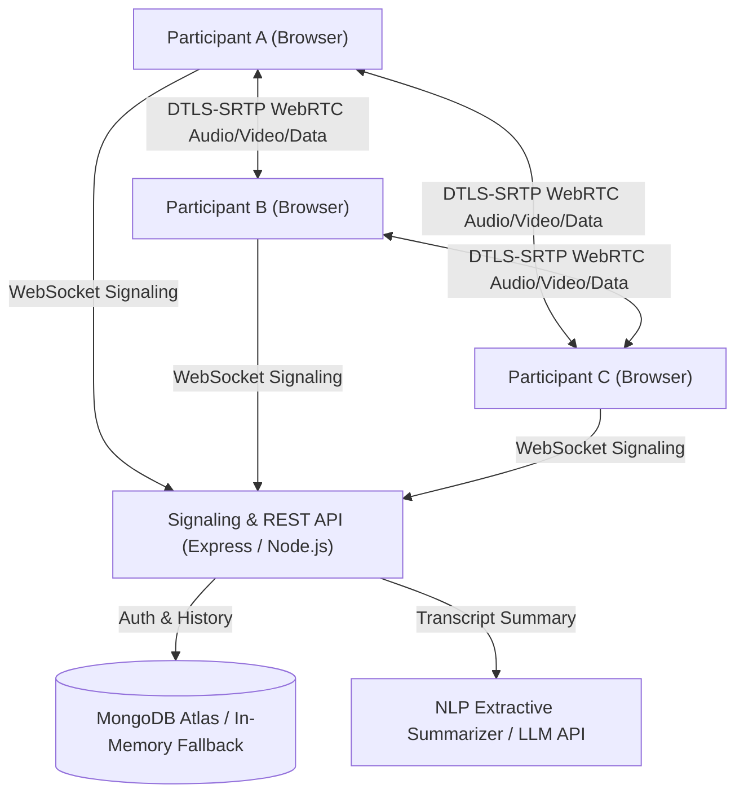

# 🎥 Streamly — Production-Grade Video Meeting Platform

> **"Meet in one click. No downloads. No accounts required. Works on bad internet."**

Streamly is a zero-friction, privacy-first, low-bandwidth-friendly video conferencing web application. Built with modern WebRTC, React 18, Node.js, and Socket.io, it allows users to jump into encrypted meetings instantly without forced registration, software downloads, or invasive tracking.

[](https://reactjs.org/)
[](https://nodejs.org/)
[](https://socket.io/)
[](https://mui.com/)
[](https://webrtc.org/)
[](https://www.mongodb.com/)

---

## ⚡ Problems Streamly Solves

| Problem in Zoom / Meet / Teams | Streamly Solution |
| :--- | :--- |
| **Forced sign-ups & app installs** | Instant guest join via URL with just a display name; accounts are completely optional |
| **Calls drop on poor internet** | Dynamic low-bandwidth mode (360p / 15fps), audio prioritization, and auto `iceRestart` |
| **Unwanted intruders ("Zoom-bombing")** | Waiting room with host approvals, room locking, optional passwords, and server-enforced permissions |
| **Meetings produce zero usable output** | Free live speech captions, shared whiteboard, synced notes pad, transcript collection, and AI summaries |
| **Cluttered, bloated UI** | Dark-mode, distraction-free interface with glassmorphism controls and keyboard shortcuts (`M`, `V`, `S`, `C`, `H`, `P`, `?`) |
| **Privacy concerns & server storage** | P2P media streams (never stored on server), local client-side recording, and zero tracking |

---

## 🏗️ System Architecture

Streamly uses a P2P WebRTC Mesh for media transport and Socket.io for WebSocket signaling and collaborative state synchronization.




---

## 🚀 Key Features

### 1. Hardened Core Calling
- **W3C Perfect Negotiation:** Eliminates negotiation glare and race conditions using deterministic politeness.
- **Pre-join Lobby Screen:** Live camera preview, real-time audio meter, mic/camera/speaker selector, and server latency (RTT) ping test.
- **Reactive Layouts:** Grid view, Spotlight mode (active speaker large), and Sidebar strip (pinned user or screen share).
- **Active Speaker Highlighting:** Powered by Web Audio API frequency analysis with glowing borders.
- **Picture-in-Picture (PiP):** Multitask while keeping video in view.
- **Screen Sharing:** High-resolution desktop/window sharing with native browser stop-share integration.

### 2. Bad Network Resilience
- **Auto Quality Adaptation:** Continuous polling of `getStats()` every 3s monitoring RTT, packet loss, and bitrate.
- **Low-Bandwidth Mode:** Dynamic throttling via `RTCRtpSender.setParameters` (capping video to 360p / 15fps / 200kbps) prioritizing audio continuity.
- **Auto-reconnection:** WebSocket re-establishment and automatic WebRTC `iceRestart` upon network drops.

### 3. Security & Host Moderation
- **Waiting Room:** Host controls entry with Admit, Admit All, and Deny actions.
- **Room Lock:** Host can lock the meeting room to prevent new entries.
- **Host Controls:** Mute individual participant, Mute All, Transfer Host, and End Meeting for All.
- **Optional Meeting Passcode:** Salted and hashed on the server with bcrypt.

### 4. Real-Time Collaboration
- **In-Meeting Chat:** Timestamps, unread message badges, URL auto-detection, private direct messages, typing indicators, and file/image sharing (up to 10MB).
- **Shared Whiteboard:** Interactive canvas with pen, eraser, brush size slider, color palette, and one-click PNG export.
- **Collaborative Notes:** Debounced Markdown scratchpad auto-synced across participants, downloadable as `.md`.
- **Live Polls:** Host creates polls with real-time percentage progress bars.
- **Reactions & Hand Raise:** Floating emoji confetti and queue of raised hands for the host.

### 5. AI & Accessibility
- **Free Live Captions:** Browser-native Web Speech API speech-to-text with multi-language selection.
- **Meeting Transcript & AI Summary:** Captions are collected into a timestamped transcript. At the end of the meeting, an extractive NLP engine generates meeting overviews, key decisions, and action items with owners (with optional LLM integration).
- **Keyboard Shortcuts:** `M` (mute), `V` (video), `S` (share), `C` (chat), `H` (hand raise), `P` (participants), `?` (help).
- **Local Recording:** Records composite stream directly in-browser using `MediaRecorder` to `.webm` with zero cloud media ingress.

---

## 🛠️ Tech Stack

- **Frontend:** React 18, Material UI (MUI v5), Socket.io-client, Axios, React Router v6, Canvas Confetti, Web Audio API, Web Speech API, MediaRecorder.
- **Backend:** Node.js, Express, Socket.io, Mongoose (MongoDB), JWT (jsonwebtoken), bcrypt, helmet, cookie-parser, express-rate-limit.
- **Testing & Quality:** Node.js Native Test Runner (`node --test`), automated unit tests.

---

## ⚡ Quick Start (Local Setup)

### Prerequisites
- Node.js 18+ (tested on Node 20 & 25)
- npm 9+

### 1. Clone the repository
```bash
git clone https://github.com/your-username/streamly.git
cd streamly
```

### 2. Start the Backend
```bash
cd backend
npm install
npm test            # Runs unit tests (100% pass)
npm run dev         # Starts server on http://localhost:8000
```
> *Note: If `MONGO_URI` is not configured, the backend automatically operates in in-memory guest mode so all video calls, chat, whiteboard, and signaling work immediately!*

### 3. Start the Frontend
In a new terminal:
```bash
cd frontend
npm install
npm start           # Starts development app on http://localhost:3000
```

---

## ⚙️ Environment Variables

### Backend (`backend/.env`)

| Variable | Description | Default | Required? |
| :--- | :--- | :--- | :--- |
| `PORT` | Backend server port | `8000` | No |
| `NODE_ENV` | Environment mode | `development` | No |
| `FRONTEND_URL` | Frontend origin for CORS | `http://localhost:3000` | No |
| `MONGO_URI` | MongoDB Atlas URI | *(In-memory fallback if blank)* | Optional |
| `JWT_ACCESS_SECRET` | Secret key for access token | *(Built-in dev secret)* | Production |
| `JWT_REFRESH_SECRET` | Secret key for refresh token | *(Built-in dev secret)* | Production |
| `TURN_SERVER_URL` | STUN / TURN server address | `stun:stun.l.google.com:19302` | Optional |
| `TURN_USERNAME` | TURN authentication username | - | Optional |
| `TURN_CREDENTIAL` | TURN authentication password | - | Optional |
| `LLM_API_KEY` | Optional Gemini/OpenAI API key | *(Uses free NLP extractive summary)* | Optional |

### Frontend (`frontend/.env`)

| Variable | Description | Default |
| :--- | :--- | :--- |
| `REACT_APP_BACKEND_URL` | Backend URL for API & WebSockets | `http://localhost:8000` |

---

## 📈 Scalability: P2P Mesh vs. SFU Upgrade Path

Streamly is currently optimized as a **P2P Mesh** network:
- **Bandwidth Profile:** Each participant sends their stream to $N-1$ peers and receives $N-1$ streams.
- **Ideal Capacity:** Up to 6 concurrent participants per room.
- **Advantages:** Zero server media processing overhead, zero relay hosting costs, end-to-end encrypted privacy.

### SFU Upgrade Path (mediasoup / LiveKit)
To scale rooms to 50–100+ participants:
1. Replace mesh peer connections with an SFU router connection.
2. Each participant publishes 1 upstream video/audio track to the SFU.
3. The SFU forwards tracks downstream based on active speaker detection and tile visibility.
4. Client interface in `PeerManager.js` is already decoupled to support this transition.

---

## 🧪 Testing

Run backend test suite:
```bash
cd backend
npm test
```
Runs 7 automated tests covering:
- Meeting code generation & regex validation
- Code normalization and sanitization
- Extractive NLP summary decision extraction & action items mapping
- Empty transcript error handling
- JWT Access token signing & verification
- JWT Refresh token rotation & signature validation


